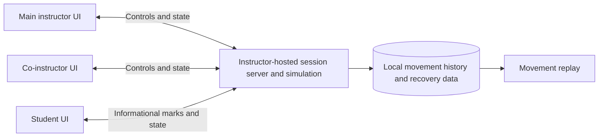

# ATC Trainer: High-Level Software Specification

Date: 2026-11-26

Status: Written for review following confirmation of the product brief. This is a product and architecture baseline, not an implementation plan or a completed specification of every controller workflow.

## 1. Purpose and document precedence

Build an instructor-led ATC trainer for both learning controller operations and practising complex traffic situations. IVAO controllers are the primary audience, but the application serves controllers more generally.

The student experience should resemble IVAO Aurora in appearance, information presentation and controller workflows. Usability improvements are allowed. The instructor has a separate traffic-management interface suited to operating simulated aircraft.

This document supersedes conflicting product requirements in the [historical software design](../../atc-training-software-design.md). That document's frozen v1 scope and the earlier technical/protocol designs do not constrain this product. This document does not claim the new requirements are implemented.

## 2. Product boundaries

- Native Rust desktop application using [GPUI](https://gpui.rs/).
- Native builds for Windows, macOS and Linux. All initial controller displays are 2D.
- The main instructor hosts the server through the application. The co-instructor and student connect remotely over the Internet.
- One student per session initially. Up to four observers are part of the intended product; observer permissions and delivery timing are deferred.
- Aircraft count is variable, without a fixed product cap. This does not assert unlimited hardware capacity.
- No connections to third-party services, live ATC networks or external flight simulators.
- No built-in voice or Discord/TeamSpeak integration. Participants arrange simulated radio communication separately using those applications.
- No weather simulation initially. Scenario-defined weather was considered and deferred.
- Delivery proceeds through ground, tower, approach and area control, in that order.

GPUI documents Windows, macOS and Linux support, including Wayland and X11 on Linux. It is still pre-1.0 and may introduce breaking changes. These are documented framework capabilities, not proof that this application's builds work on all platforms. See the [official GPUI README](https://github.com/zed-industries/zed/tree/main/crates/gpui).

## 3. Session architecture and responsibilities

The main instructor's application hosts the authoritative session server and simulation. Connected applications send permitted actions and render synchronized aircraft state. They do not independently determine canonical aircraft movement.

Sector rendering uses each client's local files. The host communicates the required sector identity; it does not distribute sector packs to guests. The exact sector-identification and version-matching rules need a separate data contract.

The following boundaries describe responsibilities, not a requirement to create additional crates or services:

| Responsibility | Owns |
| --- | --- |
| Session server | Membership, role authorization, lifecycle and ordering of accepted actions |
| Simulation | Aircraft physical state and responses to instructor commands |
| Sector and profile loading | Local IVAO sector data, ground extensions and aircraft performance profiles |
| GPUI interface | Role-appropriate controls, 2D displays, local viewing state and student marks |
| Recording and recovery | Durable movement history and sufficient state to resume an interrupted exercise |

Existing Rust client-core, server and shared-protocol code are the starting point. Reuse is subject to the new requirements; this document does not prescribe a transport replacement, storage engine or GUI migration strategy.

### Roles and entry

| Role | Responsibility and authority |
| --- | --- |
| Main instructor | Hosts the server, generates invitations, operates aircraft and manages hosting and explicit session end |
| Co-instructor | Has the same operational aircraft and exercise controls as the main instructor; does not own hosting or explicit session end |
| Student | Occupies one controller position and maintains informational aircraft marks; cannot drive aircraft movement |
| Observer | Up to four are intended; visibility, permissions and admission details remain deferred |

The main instructor generates separate join strings for the student and co-instructor. A join string grants its intended role; a joining client must not elevate its permissions by selecting a different role. User accounts are not required for these invitation-based roles.

Retain the simplicity of the existing generated-string approach, while extending it to co-instructor admission. Do not freeze the current `join-XXXXXX` syntax or assume the existing configured trainer credential satisfies the new hosting flow.

The code currently treats a join string as an access credential, with a separately entered server address. A generated string does not by itself make the host reachable over the Internet. The new connection experience remains an engineering requirement to resolve below.

## 4. Local data and scenario setup

### Sector data

The application must understand IVAO Aurora sector packages. The supplied `ukbu-aurora` directory is the initial concrete compatibility reference, not a hardcoded restriction to one region or fictional airport.

Sector support must distinguish display information from executable movement information. The inspected package includes airspace, navigation data, runways, airport geometry, taxi centreline segments, stop bars, stands and procedure definitions. Drawing geometry alone does not establish a validated taxi-routing graph or a complete aircraft flight model.

An extended sector format must describe the named ground anchors, their movement capabilities, relevant routing information and taxi-speed information. Exact syntax and geometry/connectivity representation are deferred. Existing IVAO files and added simulation data must remain distinguishable; the extension must not require modifying Aurora itself.

Clients identify and open the required sector locally. Unavailable or incompatible local data must be reported rather than silently replaced by the prototype's unrelated built-in airport. How versions are identified and compatibility is checked belongs in the sector-data specification.

### Scenario files

Scenarios describe initial setup only. They must define:

- Aircraft and their initial locations.
- Their flight plans.
- Their initial operational states, for example empty/no clearance, clearance received, pushback cleared, startup cleared, taxi-out/in cleared or takeoff cleared.
- The initial physical state needed to place and simulate each aircraft consistently.

These state examples are not a complete enumeration, mandatory sequence or complete ground-training task list. Exact flight-plan fields and initial-state serialization remain to be specified.

Scenario files do not script movement, future traffic appearances or timed exercise events. Instructors direct all aircraft movement during the exercise.

### Aircraft performance files

Support local import of Little Navmap `.lnmperf` aircraft performance profiles. This is file compatibility, not a connection to the Little Navmap application or an online service.

The documented XML profiles supply phase speeds and climb/descent rates, along with flight-planning data. Speeds are TAS in knots; vertical speeds are feet per minute. They do not supply acceleration, braking, turn dynamics, taxi speed or pushback dynamics. Importing them therefore does not by itself satisfy the realistic-motion requirement. See the [format documentation](https://www.littlenavmap.org/manuals/littlenavmap/release/latest/en/FILES.html#aircraft-performance-file-format) and [published schema](https://www.littlenavmap.org/schema/lnmperf.xsd).

Source/profile mapping, supported file versions, legacy INI compatibility and missing motion parameters require a later data-and-simulation design. No fallback performance constants have been agreed beyond the taxi-speed defaults below.

## 5. Instructor control and student information

The instructor operates the aircraft and sets movement instructions, including speed, heading/direction and altitude. The simulator computes the physical response, including acceleration, deceleration, climb and descent, as realistically as possible.

An instructor command is not an instantaneous change in actual aircraft speed or altitude. Appropriate performance models and measurable accuracy criteria still need to be established; the phrase "as realistically as possible" is a goal, not a verified accuracy claim.

The initial operational-status model uses one current status rather than multiple simultaneous clearance flags. Student information and instructor movement control are independent:

- The student records informational status in aircraft labels or departure/arrival control lists.
- The instructor uses the traffic-management system to control movement.
- A missing or incorrect student mark must not prevent or initiate aircraft movement.
- Instructor movement must not automatically replace the student's independently maintained clearance mark.

The exact mapping of scenario initial operational state into the two roles' initial views remains part of the ground-stage design. Independence must not be lost by reusing one shared status field for both purposes.

Departure and arrival lists are required. Their appearance and detailed interactions will follow a reference supplied by the user. Instructor interface design is a separate discussion; this document does not freeze the prototype's panels or controls.

## 6. Agreed ground-movement baseline

The following details have already been agreed and should be preserved when the ground stage is specified further.

### Route selection and anchors

- The instructor selects the exact ordered sequence of named anchors by clicking them.
- Movement happens between those selected anchors. Automatic destination-based route finding is not required by this baseline.
- Visible pushback anchors are available on aprons and taxi lines; taxi anchors are available on taxi lines and runways.
- Anchors have complementary capabilities rather than one exclusive operation type.
- `TAXI` is the default capability. An additional `PUSHBACK_FACING_XXX` capability permits pushback ending at that anchor with the specified final aircraft heading.
- A single anchor may support several pushback-facing directions as well as taxi movement.

These labels describe semantics, not a finalized file grammar. Heading notation and reference conventions remain to be defined. Live route-editing behaviour was explicitly left undecided and must not be inferred from this route-selection requirement.

### Taxi speeds

| Taxiway classification | Initial default target speed |
| --- | --- |
| Standard taxiway | 15 kt |
| Main / magistral taxiway | 30 kt |

Anchors carry this taxi-speed information. These values are default targets, not enforced maximums; instructors may override them. Acceleration and deceleration must be computed instead of snapping to the target speed.

Pushback speed, acceleration/braking parameters, intermediate stopping rules and the exact point at which an anchor's speed information applies are not yet specified.

## 7. Persistence, recovery and replay

Every applied aircraft movement must be durably recorded, in order and with timing sufficient to reproduce it. Recording only the instructor's intended path or commands is insufficient for the agreed movement replay.

An application interruption is not an explicit session end. An interrupted exercise must remain recoverable from persisted session state rather than restarting from the scenario's initial setup. Recovery needs enough current session and aircraft state in addition to movement history; its representation and durability mechanism are not selected here.

Explicit session end stops the live exercise and recording. It does not delete the history. Recordings remain available locally for replay and debriefing until the instructor explicitly deletes them.

Initial replay covers aircraft movement only. Later, once the product has taken shape, extend replay to instructor commands and student informational marks. Persisting current non-movement state for recovery does not require exposing its full history in the initial replay interface.

Playback controls, recording format, storage location, export/sharing, crash consistency and the persistence of supporting sector/profile references require a focused design. Resume/recovery and replay are separate operations; replay does not imply branching an exercise from any point on a timeline.

## 8. Delivery stages

These are capability stages, not implementation tasks or commitments to unapproved detailed workflows. Shared platform, data, session and recording capabilities support each stage.

| Order | Stage | Capability objective |
| --- | --- | --- |
| 1 | Ground | Instructor-operated pushback and taxi using extended-sector anchors; initial scenarios, flight plans, independent student marks, departure/arrival lists, persistence, recovery and movement replay |
| 2 | Tower | Runway and aerodrome-control training, including support for VFR traffic patterns |
| 3 | Approach | Arrival/departure and approach-control training using the shared aircraft simulation and sector procedures |
| 4 | Area control | En-route and area-control training extending the same client/server system |

The initial airborne procedure capability must support flying SIDs and STARs from IVAO-based sector files. The precise allocation between tower and approach delivery, and the procedure semantics supported at each milestone, need stage-level specifications; SID/STAR support must not be silently deferred to a distant optional integration.

Ground operational requirements beyond the agreed baseline, and detailed tower/approach/area workflows, are deferred rather than assumed complete. Later work must define concrete exercises and acceptance cases for each position, including the interaction between ground, runway and airborne movement.

## 9. Acceptance scenarios for the baseline

These are verification targets for future implementation, not checks reported as executed. Detailed tolerances and platform test environments must be supplied in the relevant implementation specifications.

| Area | Required observable result |
| --- | --- |
| Platform | The same product can host or join using native GPUI builds on Windows, macOS and Linux, with 2D displays |
| Roles | Main instructor, co-instructor and one student can participate with their intended permissions; role selection cannot elevate a join string's authority |
| Local sector | A joining client identifies and opens the intended local sector; no host-distributed sector pack is required |
| Scenario | Loading a scenario restores its initial aircraft locations, flight plans and operational states without scripted movements |
| Ground routes | Clicking named anchors determines route order, and a pushback-capable endpoint produces the selected final heading |
| Speed response | Taxi targets default to 15/30 kt as appropriate, allow instructor override and change through computed acceleration/deceleration |
| Role independence | Changing a student mark does not command aircraft movement; an instructor movement command does not overwrite that mark |
| Student display | Aircraft labels and departure/arrival lists expose informational aircraft status, with layout checked against the forthcoming reference |
| Recovery | Interrupting and restarting the host allows the exercise to be recovered from durable state rather than its initial scenario |
| Replay | Stored movements reproduce recorded aircraft motion in order and timing without requiring richer command/mark replay initially |
| Session end | Explicit end stops recording but preserves a recording that can be reopened until explicitly deleted |
| External independence | A training session requires no application connection to voice services, live networks, flight simulators, weather providers or other third-party services |

Remote hosting acceptance must additionally demonstrate the agreed start-and-join experience against explicitly validated network conditions. The feasibility issue below prevents treating universal zero-configuration reachability as already solved.

## 10. Open technical questions and deliberately deferred work

### Internet reachability: unresolved feasibility constraint

The intended experience is that the main instructor starts hosting, shares connection information and other participants join without configuring routers or networking. The application must also avoid third-party services.

These are retained product requirements, but no implementation has been validated that guarantees this combination on arbitrary consumer networks. ISP shared-address space is not globally routable, and NAT traversal distinguishes direct host candidates from addresses discovered or reached using additional infrastructure. A join string cannot create reachability. See [RFC 6598, section 1](https://www.rfc-editor.org/rfc/rfc6598.html#section-1) and [RFC 8445, section 2.1](https://www.rfc-editor.org/rfc/rfc8445.html#section-2.1).

Consequently, universal zero-configuration direct hosting cannot be promised from the invitation mechanism alone. This is a feasibility conclusion, not approval to add discovery/relay services, require user network configuration or drop Internet support. Establish supported network conditions and resolve this conflict before claiming the hosting requirement is implemented.

### Further specifications

| Topic | What remains to be settled |
| --- | --- |
| Instructor UI | Convenient traffic-management and movement controls; discuss separately |
| Student lists | Departure/arrival reference, layout, fields and interactions |
| Observer support | Permissions, visible information, invitations and delivery timing; keep the agreed maximum of four |
| Sector data | Import compatibility, local identity/version matching, ground extension syntax and routing geometry |
| Scenarios | Complete flight-plan/state fields and initialization of independent role views |
| Aircraft motion | Supplementary performance data, aircraft/profile mapping, physical response models and measurable realism criteria |
| Ground operations | Complete exercise workflows, status vocabulary, pushback/stop semantics and remaining movement rules |
| Recording | Storage, crash consistency, replay/recovery interfaces and local supporting-data dependencies |
| Later stages | Detailed tower, approach and area exercises, including VFR circuits and early SID/STAR flying |

These deferred areas are visible boundaries of the current high-level specification. They are not permission to invent requirements during implementation.

## 11. Existing implementation evidence

The following observations ground this specification in the current prototype. They describe inspected source, not interactive verification:

- `crates/atc-server/src/sessions.rs` generates a student join string. `crates/atc-server/src/http.rs` admits the student using that string and separately checks a configured trainer credential.
- `crates/atc-client/src/sector_viewer.rs` starts a host from a loaded Aurora sector and accepts a host address and join string in student mode.
- `crates/atc-client/src/sector_viewer/student.rs` compares the host's sector identity with the sector loaded locally by the student.
- The server moves aircraft along instructor paths. IVAO importing, realistic aircraft responses and durable replay must be implemented and verified separately.

The existing code and historical documents are useful migration inputs, but passing their current tests would not establish compliance with this specification.
