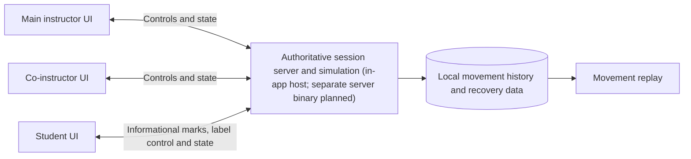

# ATC Trainer: High-Level Software Specification

Date: 2026-11-26

Status: Written for review following confirmation of the product brief. This is a product and architecture baseline, not an implementation plan or a completed specification of every controller workflow.

## 1. Purpose and document precedence

Build an instructor-led ATC trainer for both learning controller operations and practising complex traffic situations. IVAO controllers are the primary audience, but the application serves controllers more generally.

The student experience should resemble IVAO Aurora in appearance, information presentation and controller workflows. Usability improvements are allowed. The instructor has a separate traffic-management interface suited to operating simulated aircraft.

This document supersedes conflicting product requirements from the earlier historical v1 software and protocol designs (previously archived in git history). Those frozen v1 scopes and earlier technical/protocol designs do not constrain this product. This document does not claim the new requirements are implemented.

## 2. Product boundaries

- Native Rust desktop application using [GPUI](https://gpui.rs/).
- Native builds for Windows, macOS and Linux. All initial controller displays are 2D.
- Hosting modes for remote sessions:
  1. **Direct instructor-hosted session via IP (primary / initial mode)**: the main instructor hosts the server through the desktop application and the co-instructor and student connect directly to the host's IP/address (over LAN, VPN/mesh, or port-forwarded/public IP).
  2. **Separate self-hostable server binary (planned for a later revision)**: allows participants to join a hosted server without exposing an instructor's personal IP address or traversing consumer NAT.
- One student per session initially. Up to four observers are part of the intended product; observer permissions and delivery timing are deferred.
- Aircraft count is variable, without a fixed product cap. This does not assert unlimited hardware capacity.
- No connections to third-party services, live ATC networks or external flight simulators. (The optional separate server binary is a first-party, self-hostable component of this product, not a third-party service.)
- No built-in voice or Discord/TeamSpeak integration. Participants — including main and co-instructors coordinating aircraft control — arrange simulated radio and coordination voice communication separately using those applications.
- No weather simulation until the latest stage of development; delivering practical controller training without weather takes priority over delaying training for weather modeling.
- Delivery proceeds through ground, tower, approach, area control, and finally weather influence, in that order.

GPUI documents Windows, macOS and Linux support, including Wayland and X11 on Linux. It is still pre-1.0 and may introduce breaking changes. These are documented framework capabilities, not proof that this application's builds work on all platforms. See the [official GPUI README](https://github.com/zed-industries/zed/tree/main/crates/gpui).

## 3. Session architecture and responsibilities

The authoritative session server and simulation initially run inside the main instructor's desktop application (direct IP hosting), with a separate self-hostable server binary planned for a later revision to avoid exposing instructor IPs. Connected applications send permitted actions and render synchronized aircraft state. They do not independently determine canonical aircraft movement.

Sector rendering uses each client's local files. The host communicates the required sector identity; it does not distribute sector packs to guests. The exact sector-identification and version-matching rules need a separate data contract.

The following boundaries describe responsibilities, not a requirement to create additional crates or services:

| Responsibility | Owns |
| --- | --- |
| Session server | Membership, role authorization, lifecycle and ordering of accepted actions |
| Simulation | Aircraft physical state and responses to instructor commands |
| Sector and profile loading | Local IVAO sector data, ground extensions and aircraft performance profiles |
| GPUI interface | Role-appropriate controls, 2D displays, local viewing state and student marks |
| Recording and recovery | Durable movement history and sufficient state to resume an interrupted exercise |

Existing Rust client-core, server and shared-protocol code are the starting point. Reuse is subject to the new requirements; this document does not prescribe a transport replacement, storage engine or GUI migration strategy.

### Roles and entry

| Role | Responsibility and authority |
| --- | --- |
| Main instructor | Owns session lifecycle (in-app hosting or server session creation, invitations, explicit session end) and has full operational aircraft and transfer controls |
| Co-instructor | Has the same operational aircraft, exercise, and neighbor-transfer controls as the main instructor; does not own hosting or explicit session end |
| Student | Occupies one controller position, maintains informational aircraft marks, and manages aircraft label control (`free`, `assumed`, `transferred`); cannot drive aircraft movement |
| Observer | Up to four are intended; visibility, permissions and admission details remain deferred |

The main instructor generates separate join strings for the student and co-instructor. A join string grants its intended role; a joining client must not elevate its permissions by selecting a different role. User accounts are not required for these invitation-based roles.

Retain the simplicity of the existing generated-string approach, while extending it to co-instructor admission. Do not freeze the current `join-XXXXXX` syntax or assume the existing configured trainer credential satisfies the new hosting flow.

The code currently treats a join string as an access credential, with a separately entered server address. Initially, direct in-app hosting connects via the instructor's IP/address; the planned separate self-hostable server binary will later allow joining without sharing an instructor's personal IP. Transport security (encryption in transit), invitation lifecycle/revocation, and reconnection tokens belong in the session-and-networking specification.

## 4. Local data and scenario setup

### Sector data

The application must understand IVAO Aurora sector packages. The supplied `ukbu-aurora` directory is the initial concrete compatibility reference, not a hardcoded restriction to one region or fictional airport.

Sector support must distinguish display information from executable movement information. The inspected package includes airspace, navigation data, runways, airport geometry, taxi centreline segments, stop bars, stands and procedure definitions. Drawing geometry alone does not establish a validated taxi-routing graph or a complete aircraft flight model.

An extended sector format must describe the named ground anchors, their movement capabilities, relevant routing information and taxi-speed information. Exact syntax and geometry/connectivity representation are deferred. Existing IVAO files and added simulation data must remain distinguishable; the extension must not require modifying Aurora itself.

Clients identify and open the required sector locally. Unavailable or incompatible local data must be reported rather than silently replaced by the prototype's unrelated built-in airport. How versions are identified and compatibility is checked belongs in the sector-data specification.

### Scenario files

Scenarios describe initial setup only. Each per-exercise scenario file references a specific FIR sector file and stays separate from per-airport extended sector data (such as ground anchors). Scenarios must define:

- Aircraft and their initial locations.
- Their flight plans.
- Separate initial state fields for the two roles so independence is preserved at load time:
  - **Initial physical/simulator state** needed to place and simulate each aircraft consistently.
  - **Initial student informational state and label control state** (for example empty/no clearance, clearance received, pushback cleared, startup cleared, taxi-out/in cleared or takeoff cleared; and initial label control `free`, `assumed`, or `transferred`).

These state examples are not a complete enumeration, mandatory sequence or complete ground-training task list. Exact flight-plan fields and initial-state serialization remain to be specified.

Scenario files are loaded on the host/server and the resulting session and aircraft state is sent from the server to all connected clients; guest clients do not need local scenario files. Scenario files do not script movement, future traffic appearances or timed exercise events. Instructors direct all aircraft movement during the exercise.

### Aircraft performance files

Support local import of Little Navmap `.lnmperf` aircraft performance profiles. This is file compatibility, not a connection to the Little Navmap application or an online service.

The documented XML profiles supply phase speeds and climb/descent rates, along with flight-planning data. Speeds are TAS in knots; vertical speeds are feet per minute. They do not supply acceleration, braking, turn dynamics, taxi speed or pushback dynamics. Importing them therefore does not by itself satisfy the realistic-motion requirement. See the [format documentation](https://www.littlenavmap.org/manuals/littlenavmap/release/latest/en/FILES.html#aircraft-performance-file-format) and [published schema](https://www.littlenavmap.org/schema/lnmperf.xsd).

By default, the application must embed built-in performance profiles for **A320, B737, and C172** (high priority in the corresponding implementation phase). If another aircraft's specific `.lnmperf` profile is missing, the simulator falls back to an available profile matching a similar wake-turbulence category rather than failing session startup. Exact source/profile mapping, wake-turbulence fallback selection rules, supported file versions, legacy INI compatibility and missing motion parameters require a later data-and-simulation design. No fallback performance constants have been agreed beyond the taxi-speed defaults below.

## 5. Instructor control and student information

The instructor operates the aircraft and sets movement instructions, including speed, heading/direction and altitude. The simulator computes the physical response, including acceleration, deceleration, climb and descent, as realistically as possible.

An instructor command is not an instantaneous change in actual aircraft speed or altitude. Appropriate performance models and measurable accuracy criteria still need to be established; the phrase "as realistically as possible" is a goal, not a verified accuracy claim.

The initial operational-status model uses one current status rather than multiple simultaneous clearance flags. Student information and instructor movement control are independent:

- The student records informational status in aircraft labels or departure/arrival control lists.
- The student manages aircraft label control state (`free`, `assumed`, `transferred`) via the aircraft right-click menu.
- Both main and co-instructors can control all aircraft, initiate an **inbound transfer** from an artificial neighboring ATC position to the student, and **accept an outbound transfer** initiated by the student via the right-click menu.
- Both instructors can **view the student's informational marks read-only** for coaching and assessment, and must not overwrite them through movement commands.
- The instructor uses the traffic-management system to control movement.
- A missing or incorrect student mark or label-control state must not prevent or initiate aircraft movement.
- Instructor movement must not automatically replace the student's independently maintained clearance mark.

Scenarios seed initial physical/simulator state and initial student informational/label-control state via distinct fields in the scenario file itself; independence must not be lost by reusing one shared status field for both purposes.

Both instructors are assumed to be live humans coordinating verbally over external voice software (such as Discord). On simultaneous conflicting commands to the same aircraft, the authoritative server applies **last-write-wins** ordering and broadcasts the resulting state to all connected participants.

Departure and arrival lists are required. Their appearance and detailed interactions will follow a reference supplied by the user. Instructor interface design is a separate discussion; this document does not freeze the prototype's panels or controls.

## 6. Agreed ground-movement baseline

The following details have already been agreed and should be preserved when the ground stage is specified further.

### Route selection and anchors

- The instructor selects the exact ordered sequence of named anchors by clicking them.
- Selected and active ground routes must be visible to instructors. Detailed ground-route interactions will be finalized in the corresponding implementation phase (following the scenario format and aircraft/label rendering phase).
- Movement happens between those selected anchors. Automatic destination-based route finding is not required by this baseline.
- Visible pushback anchors are available on aprons and taxi lines; taxi anchors are available on taxi lines and runways.
- Anchors have complementary capabilities rather than one exclusive operation type.
- `TAXI` is the default capability. An additional `PUSHBACK_FACING_XXX` capability permits pushback ending at that anchor with the specified final aircraft heading.
- A single anchor may support several pushback-facing directions as well as taxi movement.

These labels describe semantics, not a finalized file grammar. Heading notation and reference conventions remain to be defined. Live route-editing behaviour was explicitly left undecided and must not be inferred from this route-selection requirement.

### Taxi speeds

| Taxiway classification | Initial default target speed |
| --- | --- |
| Standard taxiway | 15 kt |
| Main / magistral taxiway | 30 kt |

Anchors carry this taxi-speed information. On the ground (for ground and tower positions), instructors do not set custom taxi speeds manually — ground movement control consists of **move** and **stop** commands, with target taxi speeds governed by anchor classification (`15 kt` standard, `30 kt` main/magistral). Acceleration and deceleration must be computed instead of snapping to the target speed.

In addition, a taxiing aircraft must automatically **stop** if the next anchor on its route is occupied by a holding (stationary) aircraft.

### Baseline numeric rules and kinematic guardrails

Until the dedicated Aircraft Motion and Ground Operations specifications define exact curves and constants, implementations must satisfy these baseline invariants:

- **No-weather kinematics baseline**: While weather influence is deferred to the final development stage, wind is zero and standard atmosphere applies (`GS = TAS` for airborne horizontal speed).
- **Ground movement & occupied-anchor stopping**: Ground movement commands are **move** and **stop** only (no manual ground speed override). Target taxi speed follows anchor classification (`15 kt` / `30 kt`), and a moving aircraft stops before entering a next anchor occupied by a holding (non-moving) aircraft.
- **Finite monotonic speed response**: Speed changes must occur over multiple simulation ticks via finite computed acceleration/deceleration — never snapping instantaneously to the target speed in a single tick.
- **Heading & unit conventions**: `.lnmperf` speeds are TAS in knots and vertical rates are feet per minute. `PUSHBACK_FACING_XXX` defines the required final heading at the pushback endpoint; the exact heading reference frame (magnetic vs. true) and zero/360 normalization belong in the Sector Data and Ground Operations specifications.
- **Deferred formulas (very low priority)**: Exact acceleration/braking curves, turn-radius/cornering speed limits, exact anchor speed-activation trigger points, and supplementary `.lnmperf` fallback constants are deferred to the Aircraft Motion and Ground Operations specifications at **very low priority**.

## 7. Persistence, recovery and replay

> Implementation priority: persistence, crash recovery, and replay are required capabilities, scheduled at **low priority** relative to the core live training workflow.

Every applied aircraft movement must be durably recorded, in order and with timing sufficient to reproduce it. Recording only the instructor's intended path or commands is insufficient for the agreed movement replay.

An application interruption is not an explicit session end. An interrupted exercise must remain recoverable from persisted session state rather than restarting from the scenario's initial setup. Recovery needs enough current session and aircraft state in addition to movement history; its representation and durability mechanism are not selected here.

Explicit session end stops the live exercise and recording. It does not delete the history. Recordings remain available locally for replay and debriefing until the instructor explicitly deletes them.

Initial replay covers aircraft movement only. Later, once the product has taken shape, extend replay to instructor commands and student informational marks. Persisting current non-movement state for recovery does not require exposing its full history in the initial replay interface.

Playback controls, recording format, storage location, export/sharing, crash consistency and the persistence of supporting sector/profile references require a focused design. Resume/recovery and replay are separate operations; replay does not imply branching an exercise from any point on a timeline.

## 8. Delivery stages

These are capability stages, not implementation tasks or commitments to unapproved detailed workflows. Shared platform, data, session and recording capabilities support each stage.

| Order | Stage | Capability objective |
| --- | --- | --- |
| 1 | Ground | Instructor-operated pushback and taxi using extended-sector anchors; initial scenarios, flight plans, independent student marks, label control (`free`/`assumed`/`transferred`) with artificial-neighbor transfers, departure/arrival lists, persistence, recovery and movement replay |
| 2 | Tower | Runway and aerodrome-control training, including support for VFR traffic patterns |
| 3 | Approach | Arrival/departure and approach-control training using the shared aircraft simulation and sector procedures |
| 4 | Area control | En-route and area-control training extending the same client/server system |
| 5 | Weather influence | Weather modeling (wind, QNH/atmosphere, visibility/METAR effects) layered onto the completed controller-training stages |

The initial airborne procedure capability must support flying SIDs and STARs from IVAO-based sector files. The precise allocation between tower and approach delivery, and the procedure semantics supported at each milestone, need stage-level specifications; SID/STAR support must not be silently deferred to a distant optional integration.

### Implementation phases

Each high-level implementation phase maps to a GitHub Epic and builds incrementally across the delivery stages above:

| Phase | Name | Scope |
| --- | --- | --- |
| 1 | Core app & session bootstrap | GPUI app renders local IVAO Aurora airports, hosts an in-app HTTP server, verifies local sector identity, and admits a student |
| 2 | Scenarios & traffic rendering | Per-exercise scenario format (referencing a specific FIR sector file; initial aircraft with ICAO type/wake metadata, flight plans, and separate initial physical vs. student states), host-to-client state sync, and aircraft/label rendering in the required airport |
| 3 | Ground anchors & instructor ground movement | Per-airport extended sector format for ground anchors (`TAXI`, `PUSHBACK_FACING_XXX`, `15 kt` / `30 kt` taxi-speed classes), visible instructor route selection by clicking anchors, `move`/`stop` ground commands, finite accel/decel physics, and occupied-anchor auto-stop |
| 4 | Student ground workflow & transfers | Decoupled student informational marks, right-click label control (`free`/`assumed`/`transferred`), Aurora-style departure/arrival lists, read-only instructor visibility of student marks, and inbound/outbound artificial-neighbor transfers |
| 5 | Multi-instructor & direct-IP session hardening | Co-instructor join string and role permissions, server last-write-wins conflict handling, disconnect and slot takeover (replacing permanent `occupied = true`), and direct-IP remote hosting readiness |
| 6 | Tower operations & core airborne simulation (Stage 2) | `.lnmperf` performance engine (embedded **A320, B737, C172** + local import + wake-turbulence fallback; no-weather `GS = TAS`), runway operations (takeoff, landing, go-around, ground-to-runway transition), airborne commands (heading, altitude, speed), and VFR traffic patterns |
| 7 | Approach & procedure flying (Stage 3) | Parsing and flying IVAO sector SIDs and STARs, approach procedures, terminal radar layers (fixes/waypoints/TMA), and approach workflows |
| 8 | Area control (Stage 4) | En-route FIR/airway rendering, high-altitude cruise and flight levels, sector handoffs, and larger-traffic ergonomics |
| 9 | Persistence, recovery & movement replay | Low-priority durable movement history and session persistence, host crash recovery, explicit session end preserving recordings, and movement replay playback |
| 10 (Interlude) | Dedicated self-hostable server & observers | Standalone self-hostable server binary (joining without exposing instructor IP) and Observer role (up to four read-only participants); **may be executed in parallel with other phases** once live sessions are established |
| 11 | Weather influence (Stage 5) | Wind (`GS ≠ TAS`, drift, headwind/crosswind), QNH/atmosphere, and visibility/METAR effects layered onto all completed controller stages |

Ground operational requirements beyond the agreed baseline, and detailed tower/approach/area workflows, are deferred rather than assumed complete. Later work must define concrete exercises and acceptance cases for each position, including the interaction between ground, runway and airborne movement.

## 9. Edge cases and failure handling

The following edge cases define expected handling across the authoritative server and clients:

| Scenario | Priority | Required behavior |
| --- | --- | --- |
| Simultaneous main/co-instructor commands on the same aircraft | Baseline | Server serializes accepted commands using **last-write-wins** and broadcasts canonical state to all clients; instructors coordinate verbally outside the app |
| Student or co-instructor disconnects mid-session | Baseline | Session state is preserved; the disconnected slot becomes available so any person with the connection string can take the position without restarting the exercise (replacing the prototype's permanent `occupied = true` lock) |
| Host or server interruption / crash | Low | Session state is persisted so restarting resumes from durable state rather than scenario initial setup |
| Missing or incompatible local sector | Baseline | UI displays a clear error message and refuses to silently substitute an unrelated built-in airport |
| Missing or incompatible training scenario on guest | N/A | Cannot occur on guests: the host/server loads the scenario and sends canonical session/aircraft state to all connected clients |
| Missing aircraft performance file (`.lnmperf`) | Baseline | Simulator substitutes an available aircraft profile with a similar wake-turbulence category |
| Next anchor occupied by a holding aircraft | Baseline | A taxiing aircraft automatically stops rather than entering a next anchor occupied by a stationary (holding) aircraft |
| Invalid or unauthorized command | Baseline | Client UI only enables/sends valid commands for the participant's role and anchor capabilities; the authoritative server still enforces role authorization and rejects unauthorized or invalid requests without mutating state |
| Duplicate or conflicting transfer actions | Very low | Deferred hardening: reject cleanly against an invalid label-control state without affecting physical aircraft movement |

## 10. Acceptance scenarios for the baseline

These are verification targets for future implementation, not checks reported as executed. Detailed numeric tolerances (such as exact acceleration curves or platform test matrices) must be supplied in the relevant stage specifications.

| Area | Required observable result |
| --- | --- |
| Platform | Native GPUI builds compile, launch, load a local sector, host/join a session, and render the 2D sector canvas without crashing on Windows, macOS, and Linux (X11 and Wayland) |
| Hosting mode | A session can be hosted in-app by the main instructor and joined by the co-instructor and student via direct IP/address under reachable network conditions (separate self-hostable server binary acceptance is deferred to that revision) |
| Roles & conflicts | Main instructor, co-instructor, and one student operate with their intended permissions; role parameter tampering or student movement commands are rejected; co-instructor explicit session end is rejected; conflicting simultaneous instructor commands resolve deterministically via server-ordered last-write-wins |
| Local sector | Each participant downloads/provides sector packs separately; a joining client identifies and opens the matching local sector without receiving a host-distributed sector pack; a missing or mismatched local sector displays a clear error in the UI and never falls back to a built-in airport |
| Scenario & profiles | The host loads a scenario and sends initial physical aircraft locations/flight plans and separate initial student informational/label-control states to all clients (guests require no local scenario file), with zero uncommanded aircraft movement over idle time; **A320, B737, and C172** profiles are embedded by default (high priority in that phase), and any other missing `.lnmperf` profile falls back to a profile of a similar wake-turbulence category |
| Ground routes | Clicking ordered anchors `A → B → C` moves the aircraft through `A, B, C` in order and displays the route to instructors; instructors can issue **move** and **stop** commands; commanding pushback to an anchor with `PUSHBACK_FACING_H` ends at that anchor facing `H` (within tolerance defined in Ground Operations); pushback is only permitted to anchors with `PUSHBACK_FACING_*`; a taxiing aircraft stops automatically if the next anchor is occupied by a holding (stationary) aircraft |
| Speed response | On the ground (ground/tower positions), standard-classified anchors target `15 kt` and main/magistral anchors target `30 kt` with no manual ground taxi-speed override; observed speed transitions monotonically across multiple ticks via computed acceleration/deceleration rather than snapping in a single tick |
| Role independence & transfers | Changing a student mark or label-control state (`free`/`assumed`/`transferred`, via right-click menu) never commands or blocks aircraft movement; instructor movement commands never overwrite student marks; instructors view student marks read-only and can initiate inbound / accept outbound artificial-neighbor transfers via right-click menu |
| Student display | Aircraft labels and departure/arrival lists display callsign, flight-plan summary, label-control state, and student informational status, reflecting edits promptly; visual layout conformance is gated on checking in the user-supplied reference artifact |
| Disconnect & recovery | When a student disconnects, session state is preserved and any person with the connection string can take the vacant position without restarting; once low-priority persistence is implemented, abrupt host termination following `>= 1` applied movement allows recovering aircraft positions, headings, speeds, and student marks from durable state rather than scenario initial state |
| Replay | Reopening a saved recording replays recorded aircraft positions and headings in chronological order with monotonic timing matching recorded sample intervals within the Recording specification's tolerance |
| Session end | Explicit end stops recording and preserves the recording so it remains reopenable across restarts until explicitly deleted |
| External independence | A full host + co-instructor + student session runs on an isolated network with zero outbound connections to third-party services, voice servers, live ATC networks, flight simulators, or weather providers |

## 11. Open technical questions and deliberately deferred work

### Internet reachability: phased hosting modes and direct-NAT constraint

The product addresses remote hosting without relying on third-party services in two phases:

1. **Direct instructor-hosted session via IP (primary / initial mode)**, for directly reachable network conditions (LAN, user-managed VPN/mesh, or port-forwarded/public IP).
2. **Separate self-hostable server binary (planned for a later revision)**, giving participants a stable server endpoint without revealing an instructor's personal IP or depending on residential NAT traversal.

Direct zero-configuration hosting from an instructor's residential machine *without* sharing an IP and *without* any intermediary/relay server remains infeasible across arbitrary consumer networks: ISP shared-address space is not globally routable, and NAT traversal requires external discovery/relay candidates. See [RFC 6598, section 1](https://www.rfc-editor.org/rfc/rfc6598.html#section-1) and [RFC 8445, section 2.1](https://www.rfc-editor.org/rfc/rfc8445.html#section-2.1). Accordingly, initial remote hosting uses direct IP/address connection, and IP-less remote joining is targeted for the separate self-hostable server binary revision. Transport encryption, address/invitation ergonomics, and reconnect tokens require a focused session-and-networking design.

### Further specifications

| Topic | Stage gate | What remains to be settled |
| --- | --- | --- |
| Session & networking | Stage 1 (Ground) | Direct in-app host UX, TLS/transport security, co-instructor invitations, reconnect tokens, and post-crash guest reconnection (separate self-hostable server binary targeted for a later revision) |
| Instructor UI | Stage 1 (Ground) | Convenient traffic-management, movement, and artificial-neighbor transfer controls; discuss separately |
| Student lists | Stage 1 (Ground) | Departure/arrival reference artifact, layout, fields, and interactions |
| Sector data | Stage 1 (Ground) | Import compatibility, local identity/version matching, ground extension syntax, heading convention, and routing geometry |
| Scenarios | Stage 1 (Ground) | Complete flight-plan fields and separate initial physical vs. student-mark/control-state serialization |
| Aircraft motion | Stage 1 (Very low priority for detailed curves) | Supplementary performance data, aircraft/profile mapping, wake-turbulence fallback selection, detailed acceleration/braking/turn curves, and measurable realism tolerances |
| Ground operations | Stage 1 (Ground) | Complete exercise workflows, status vocabulary, pushback/stop/hold semantics, live route-editing vs. route replacement, and remaining movement rules |
| Recording | Stage 1 (Low priority) | Storage format, crash consistency, replay controls/tolerances, recovery interfaces, and local supporting-data dependencies |
| Observer support | Deferred | Permissions, visible information, invitations, and delivery timing; keep the agreed maximum of four |
| Later stages | Stages 2–5 | Detailed tower, approach, area exercises (including VFR circuits and early SID/STAR flying), and final-stage weather influence |

These deferred areas are visible boundaries of the current high-level specification. They are not permission to invent requirements during implementation.

## 12. Existing implementation evidence

The following observations ground this specification in the current prototype. They describe inspected source, not interactive verification:

- `crates/atc-server/src/sessions.rs` generates a student join string. `crates/atc-server/src/http.rs` admits the student using that string (currently locking the student slot permanently via `occupied = true`) and separately checks a configured trainer credential.
- `crates/atc-client/src/host.rs` runs an in-process Axum server bound to `127.0.0.1:0` over plain HTTP with `StudentPositionType::Gnd` and empty `trainer_hashes`, while `crates/atc-server` already exists as a separate server binary crate.
- `crates/atc-client/src/sector_viewer.rs` starts a host from a loaded Aurora sector and accepts a host address and join string in student mode.
- `crates/atc-client/src/sector_viewer/student.rs` compares the host's sector identity with the sector loaded locally by the student.
- `crates/atc-server/src/commands.rs` moves aircraft along instructor paths and currently shares `AircraftStatus` across movement and student metadata commands (allowing trainers to mutate student metadata), which must be decoupled to meet Section 5.
- IVAO importing, realistic aircraft responses, label-control transfers, and durable replay must be implemented and verified separately.

The existing code and historical documents are useful migration inputs, but passing their current tests would not establish compliance with this specification.
